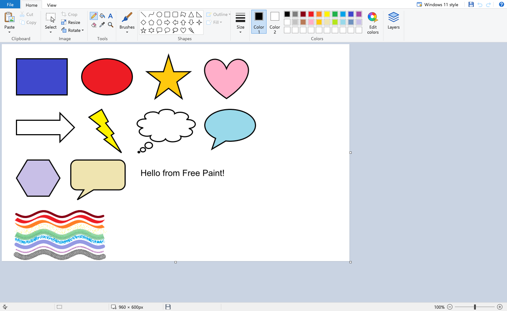
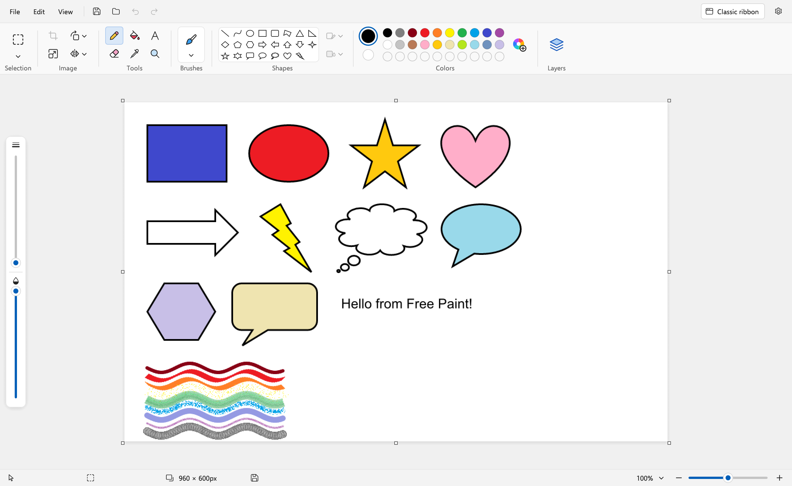
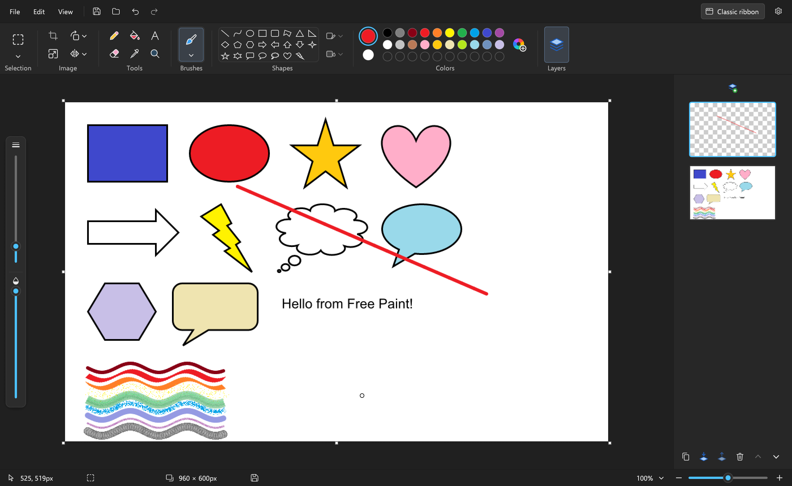
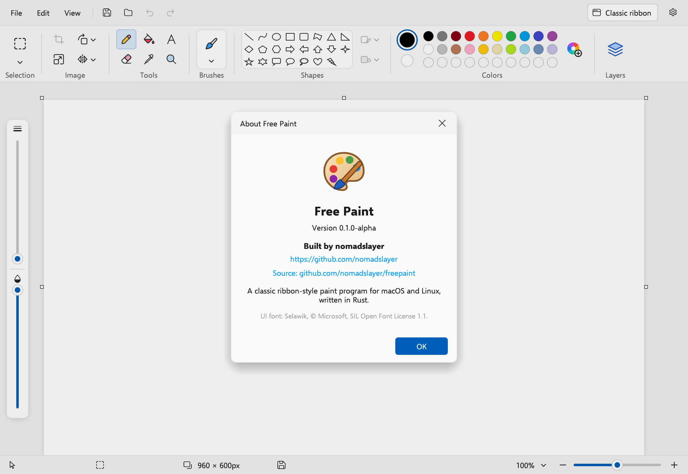

# Free Paint

**Source:** <https://github.com/nomadslayer/freepaint> · **Version:** 0.1.0-alpha (first edition)

## Download

Grab the [latest release](https://github.com/nomadslayer/freepaint/releases):

- **macOS** — `FreePaint-<version>-macos-universal.dmg` (Intel + Apple Silicon). The alpha is
  unsigned: right-click the app and choose **Open** the first time.
- **Ubuntu / Debian** — `freepaint_<version>_amd64.deb`, then `sudo apt install ./freepaint_*.deb`.
- Anything else: build from source below.

## Screenshots

| Classic (Windows 10 ribbon) | Windows 11 style |
|---|---|
|  |  |

| Dark mode with layers | About |
|---|---|
|  |  |

A classic raster paint program for **macOS and Linux**, written in Rust. Its layout follows
the Windows Paint people already know, so Windows users can work in it without relearning
anything.

It has two looks. You switch between them with a single button, and the choice is remembered:

| Style | What it looks like | Toggle button |
|---|---|---|
| **Classic ribbon** (Windows 10) | Blue **File** tab, **Home / View** tabs, big ribbon groups with labels | **"Windows 11 style"**, top-right of the tab row |
| **Windows 11 style** | **File / Edit / View** menus, a left-aligned single-row toolbar (Selection, Image, Tools, Brushes, Shapes, Colors), the picture centered with 8 resize handles, a floating size and opacity slider panel, round color swatches and rounded menus | **"Classic ribbon"**, top-right of the menu row |

The Windows 11 style **follows your desktop's light or dark mode**. To change this, open
**⚙ Settings → App theme** and choose Light, Dark or Use system setting. The classic style is
always light, as Windows 10 Paint was.

## Features

- **Tools:** pencil, fill bucket, text, eraser (right-click is a color eraser), color picker, magnifier
- **Brushes:** brush, calligraphy 1 and 2, airbrush, oil, crayon, marker, natural pencil, watercolor
- **23 shapes:** line, curve, oval, rectangles, polygon, triangles, arrows, stars, callouts, heart, lightning.
  A shape stays editable after you draw it: drag it to move it, drag a handle to resize it. Hold Shift for squares and 45° lines.
  Outline uses Color 1 and fill uses Color 2. Right-drag swaps them.
- **Selection:** rectangular or free-form, move, stretch, Ctrl/Cmd-drag to duplicate, transparent selection,
  select all, invert selection, delete, crop
- **Image:** rotate and flip (applies to the selection or the whole picture), the Resize and Skew dialog,
  image properties, invert colors, and resizing the canvas by dragging its handles
  (all 8 handles in the Windows 11 style, so the canvas can also grow left and up)
- **Layers** (both styles): the Layers button (after Colors) opens a panel on the right.
  Add (＋), hide and show, duplicate, merge down or up, reorder and delete layers — from the
  panel's buttons or by right-clicking a layer, like the real app. Shortcuts: Shift+⌘H hides
  the active layer, Shift+⌘PgUp / Shift+⌘PgDn move it, Shift+⌘Delete deletes it. The eraser
  erases to transparency on layers above the background, hidden areas show a checkerboard,
  and pictures are flattened when saved.
- **Size and opacity** (Windows 11 style): drag the floating vertical sliders on the left to set any tool size
  from 1 to 212px and the opacity of the pencil, brushes and shapes; the scroll wheel over a slider
  nudges it one step at a time
- **Colors:** the 20-color palette, 10 custom slots, and an Edit Colors dialog with a spectrum and HSL/RGB fields
- **Text:** system fonts (Arial, Times, Courier, DejaVu, Liberation, Noto… whichever are installed),
  size, bold, italic, underline, strikethrough, opaque or transparent background
- **View:** zoom from 12.5% to 800% (slider, Ctrl/Cmd + scroll, pinch), rulers, gridlines,
  status bar, thumbnail window, full-screen view
- **Files:** open and save PNG, JPEG, BMP, GIF, TIFF and WebP (ICO can be opened too), a recent-pictures list,
  drag and drop, and a save-changes prompt before you lose work
- **Clipboard:** copy and paste images with other apps through the system clipboard
- Undo and redo (up to 50 steps)

## Build and run

Install Rust from <https://rustup.rs>, then:

```sh
cargo run --release              # start with a blank canvas
cargo run --release -- photo.png # open an image
```

The binary ends up at `target/release/freepaint`.

### Linux system packages

Debian / Ubuntu:

```sh
sudo apt install build-essential pkg-config libxkbcommon-dev libgl1-mesa-dev \
  libwayland-dev libx11-dev libxcursor-dev libxrandr-dev libxi-dev
```

Fedora:

```sh
sudo dnf install gcc pkgconf libxkbcommon-devel mesa-libGL-devel wayland-devel \
  libX11-devel libXcursor-devel libXrandr-devel libXi-devel
```

File dialogs use the XDG desktop portal, which GNOME, KDE and most other desktops provide.

## Keyboard shortcuts

On macOS, use ⌘ wherever this table says Ctrl.

| Action | Shortcut |
|---|---|
| New / Open / Save | Ctrl+N / Ctrl+O / Ctrl+S |
| Save as | F12 or Ctrl+Shift+S |
| Undo / Redo | Ctrl+Z / Ctrl+Y (or Ctrl+Shift+Z) |
| Cut / Copy / Paste | Ctrl+X / Ctrl+C / Ctrl+V |
| Select all / Delete selection | Ctrl+A / Delete |
| Crop to selection | Ctrl+Shift+X |
| Invert colors | Ctrl+Shift+I |
| Resize and skew / Image properties | Ctrl+W / Ctrl+E |
| Zoom in / out | Ctrl+PgUp / Ctrl+PgDn, or Ctrl + / Ctrl − |
| Rulers / Gridlines | Ctrl+R / Ctrl+G |
| Full screen | F11 |
| Nudge a selection | Arrow keys |
| Finish a shape or polygon | Enter (Esc also works) |

## Notes

- Every icon is an original SVG drawing in this repository. No Microsoft artwork is included,
  and this is not a Microsoft product.
- The UI font is **Selawik** (© Microsoft, SIL Open Font License 1.1). See `assets/fonts/Selawik-LICENSE.txt`.
- Settings and recent files are stored in `~/Library/Application Support/Free Paint` on macOS
  and in `~/.config/freepaint` on Linux.
- Printing goes through CUPS (`lp`): File → Print offers printer, copies, fit-to-page or actual
  size, and orientation. With no printer set up, the Preview button opens the flattened picture
  in the system viewer to print from there.
- Not implemented yet: the textured outline and fill materials (crayon, marker and so on).
  Shapes can use solid color or none.

### Developer flags

These were used for automated screenshots and UI smoke tests:

```sh
freepaint --style modern|classic   # force a style for this run (it is not saved)
freepaint --theme light|dark|system  # force the Windows 11 theme for this run
freepaint --size 1400x860          # start with this window size (or --maximized)
freepaint --demo                   # draw a sample picture
freepaint --script steps.txt       # replay clicks, drags and keys (see src/script.rs)
freepaint --screenshot out.png     # save a window screenshot and quit
```

Run the unit tests with `cargo test`.
